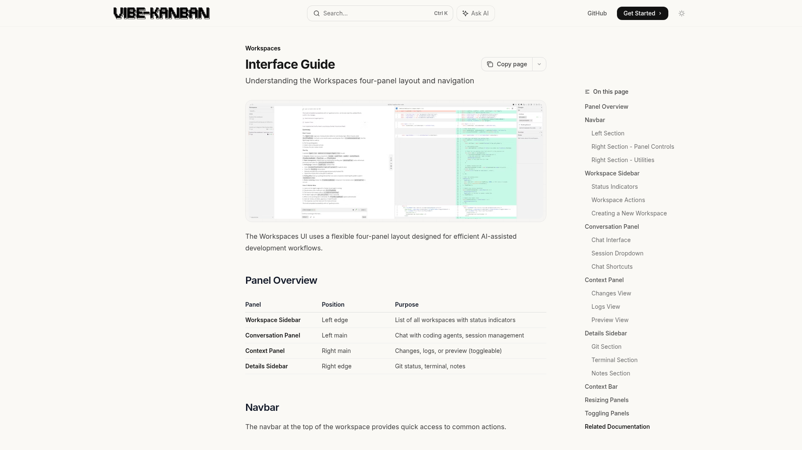
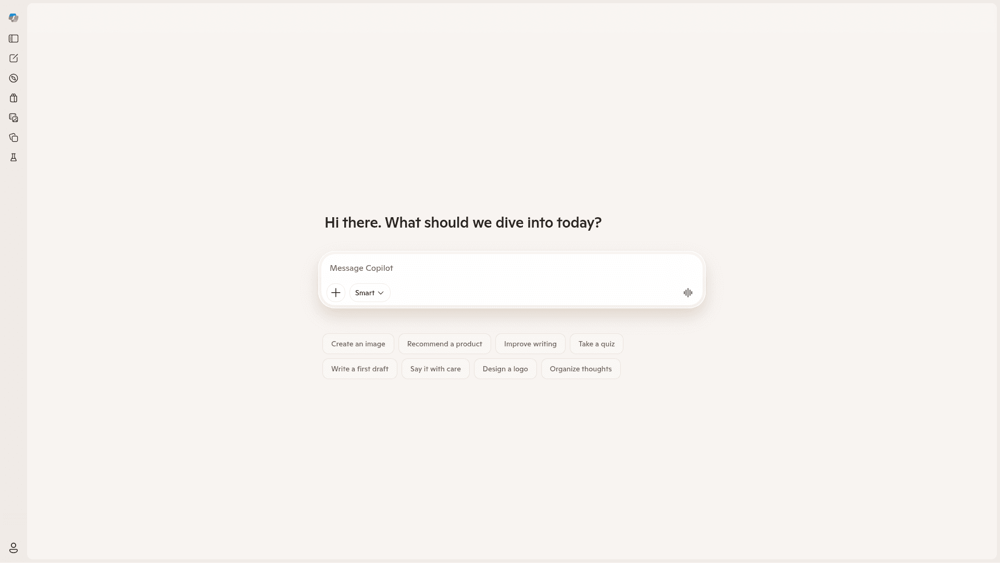
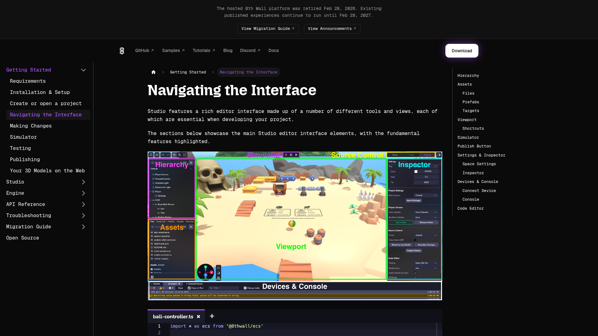

# Design Improvement: Agent Simulator

**Date:** 2026-05-15  
**Screen:** Main workspace (header + sidebars + canvas + bottom panel)

---

## TL;DR

The biggest opportunity is **space reclamation**: the bottom Task Chat panel defaults to 280px and the canvas is the primary stage. Collapsing it by default, plus surfacing Smart Mode as a visible input mode rather than a hidden toggle, would immediately make the app feel more powerful and intentional.

---

## Current State

No live screenshot was captured (browse tool unavailable). The following ASCII mockup was reconstructed from the full HTML/CSS source.

```
┌─────────────────────────────────────────────────────────────────────┐
│ ◇ Agent Simulator  ● Connected   [Export] [Reset]    [+ Agent]      │  ← 44px header
├──────────────┬──────────────────────────────────┬────────────────────┤
│ AGENTS       │  [▶ select] [✥ drag]  [⏺][▶][──]  │  Command           │
│  ● Alpha     │                                  │  $ agent1 move…  ↵ │
│  ● Beta      │                                  │  ┌─────────────────┐│
│  ● Gamma     │         Canvas 800×600           │  │ All→C  Stop  Stat││
│ OBJECTS      │         (agents moving)           │  │ Hist   Help  Reset│
│  🖥 Table 1  │                                  │  └─────────────────┘│
│  🖥 Table 2  │                                  │  LOG                 │
│  💻 PC 1    │                                  │  12:01 ✓ agent1 move│
│              │                                  │  12:02 ✓ all stop   │
├──────────────┴──────────────────────────────────┴────────────────────┤
│ ▼  TASK CHAT    [● Alpha] [● Beta] [● Gamma]              [▼ toggle] │  ← 280px tall!
│  Click agent chips above or type /agent1 to assign. Press Enter.     │
│  ┌────────────────────────────────────────────────────────────────┐  │
│  │ Type a task… /agent1 research AI trends                     →  │  │
│  └────────────────────────────────────────────────────────────────┘  │
└─────────────────────────────────────────────────────────────────────┘
```

**Key observations:**
- Bottom panel is 280px tall by default — eats ~30% of total viewport height
- Smart Mode toggle is a tiny label in the Command panel header
- 6 quick-grid buttons are visually identical (no hierarchy)
- Agent list shows only dot + name + state badge — no spatial context
- Keyboard shortcuts exist but are completely undiscoverable in-app

---

## Improvement Ideas

### 1. Collapse Bottom Panel by Default ⭐ (highest impact)

**What to change:** Set `height: 42px` as the default state for `.bottom-panel` on load. Show the Task Chat title + agent chips, but start body hidden. Users expand on demand. The current 280px default buries the canvas — the actual simulation — on every page load.

**Why it matters:** The canvas is the primary interaction surface. Currently 30%+ of vertical space is taken by a secondary feature before any agent interaction happens.

**Inspired by:**  
  
*Vibe-kanban — Four-panel workspace with collapsible bottom panel; chat stays accessible without dominating the layout [Lazyweb]*

**Sketch (collapsed state):**
```
┌─────────────────────────────────────────────────────────────┐
│  [▼] TASK CHAT    [● Alpha] [● Beta] [● Gamma]          [▲] │  ← 42px only
└─────────────────────────────────────────────────────────────┘
```

**Sketch (expanded on click):**
```
┌─────────────────────────────────────────────────────────────┐
│  [▼] TASK CHAT    [● Alpha] [● Beta] [● Gamma]          [▼] │
│  ┌───────────────────────────────────────────────────────┐   │
│  │  messages…                                            │   │  ← 200px
│  └───────────────────────────────────────────────────────┘   │
│  [ Type a task… /agent1 research AI trends            →  ]   │
└─────────────────────────────────────────────────────────────┘
```

**Implementation:** In `script.js`, on init call `BP.collapse()` or set `bottomPanel.classList.add('collapsed')` before websocket connects.

---

### 2. Make Smart Mode a First-Class Input Mode

**What to change:** Replace the tiny `<label class="smart-toggle">` inside the panel header with a visible mode pill that sits inside the command input bar itself. Two visual states: `[$ Command]` vs `[✦ Smart]`. When Smart is active, tint the `$` prompt to accent color with a sparkle prefix and show placeholder text `"Ask in natural language…"`.

**Why it matters:** Smart Mode is the AI superpower of the app, but it's a hidden toggle that most users will never notice. Making it visible and prominent signals that AI is a first-class citizen.

**Inspired by:**  
  
*Microsoft Copilot — Central AI input with an explicit mode selector and contextual suggestion chips [Lazyweb]*

**Sketch:**
```
Current:
┌─────────────────────────────────────┐
│ Command                    [Smart ○]│  ← buried toggle
│ $ agent1 move 400 300            ↵  │
└─────────────────────────────────────┘

Improved:
┌─────────────────────────────────────┐
│  [$ CMD]  [✦ SMART]                 │  ← tab/pill switcher
│  $ agent1 move 400 300           ↵  │  (CMD mode)
│                                     │
│  ✦ send everyone to the center   ↵  │  (SMART mode — purple input)
└─────────────────────────────────────┘
```

**Implementation:** Move the toggle logic to a tab strip above the input. Add a CSS class `.smart-active` on `.cmd-panel` that changes `--cmd-prompt-color` to `var(--accent)` and updates the placeholder.

---

### 3. Visual Hierarchy in Quick-Command Grid

**What to change:** The 6 quick buttons have identical appearance. Split them visually:
- **Primary actions** (mutate agent state): `All→Center`, `Stop All` → accent-tinted background (`var(--acc-bg)` + `var(--accent)` border)
- **Utility/info**: `Status`, `History`, `Help` → current muted style (fine as-is)
- **Destructive**: `Reset` → on hover, show subtle red tint (`var(--err-bg)` + `var(--err)` text)

**Why it matters:** When controlling agents in real-time, the user's eye needs to find "Stop All" instantly. Currently it reads at the same weight as "Help".

**Inspired by:**  
  
*Intercom — Agent workspace with tiered action hierarchy; primary actions are visually distinct from secondary status/config [Lazyweb]*

**Sketch:**
```
Before (all identical):
┌────────┬────────┬────────┐
│All→Ctr │Stop All│ Status │
│ History│  Help  │ Reset  │
└────────┴────────┴────────┘

After (tiered):
┌────────────┬────────────┬────────┐
│ All→Center │  Stop All  │ Status │  ← primary: accent border
│   History  │    Help    │ Reset  │  ← utility: muted / Reset: red hover
└────────────┴────────────┴────────┘
```

**Implementation:** Add classes `q-btn--primary` and `q-btn--danger` in `styles.css`. Update the 6 `<button class="q-btn">` elements in `index.html`.

---

### 4. In-App Keyboard Shortcut Strip

**What to change:** Add a single-line hint strip below the command input — visible only when the input is focused or on first visit. Shows: `Tab → autocomplete  ·  ↑↓ → history  ·  / → focus  ·  Ctrl+L → clear log`.

**Why it matters:** The app has excellent keyboard support (Tab autocomplete, command history, /, Esc, Ctrl+L) but these are completely undiscoverable in the UI. They're only in the README. Power features that users don't know exist are wasted.

**Inspired by:**  
  
*8th Wall — WebXR 3D editor showing keyboard shortcuts inline in the interface, helping developers discover navigation controls without leaving the tool [Lazyweb]*

**Sketch:**
```
┌──────────────────────────────────────────────┐
│ $ agent1 move 400 300                     ↵  │
└──────────────────────────────────────────────┘
  Tab autocomplete · ↑↓ history · / focus · Ctrl+L clear
  (10px muted text, appears on focus, fades after 5s or persists)
```

**Implementation:** Add a `<div class="cmd-hints">` div below `.cmd-input-wrap`. Show on `#cmdInput` focus via CSS `:focus-within`. Inline in `styles.css` as:
```css
.cmd-hints {
  font-size: 10px; color: var(--text-3);
  padding: 0 12px 8px; font-family: var(--mono);
  opacity: 0; transition: opacity .2s;
}
.cmd-panel:focus-within .cmd-hints { opacity: 1; }
```

---

## What's Working

1. **Design system is excellent** — The token system (`--bg`, `--surface`, `--accent`, etc.) is consistent and well-thought-out. The Raycast-inspired charcoal theme looks professional.
2. **Chain-of-thought display** — The `bp-cot-thought` left-border accent and `bp-cot-observation` green indicators are a standout UX detail for showing agent reasoning. Don't change this.
3. **Agent card delete pattern** — Delete button appears only on hover and is red-tinted. This is the right interaction model for destructive actions.
4. **Canvas toolbar separation** — Grouping tool-select/drag separately from record/playback in the same toolbar row is clean and logical.
5. **MCP preset pill design** — The `mcp-preset-btn` "added" state (green border + green text + pointer-events:none) gives clear confirmation feedback without a modal.

---

## All References

| Screenshot | Source | Relevance |
|---|---|---|
| `vibe-kanban-workspace.png` | Vibe-kanban [Lazyweb] | 4-panel collapsible workspace pattern |
| `microsoft-copilot-mode-selector.png` | Microsoft Copilot [Lazyweb] | AI mode selector in input bar |
| `intercom-agent-workspace.png` | Intercom [Lazyweb] | Tiered agent action hierarchy |
| `8thwall-canvas-editor.png` | 8th Wall [Lazyweb] | In-editor keyboard shortcut visibility |
